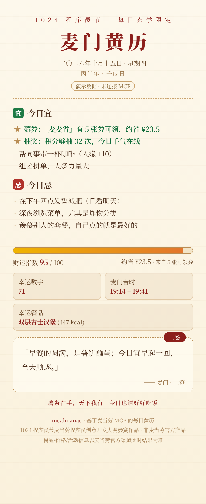
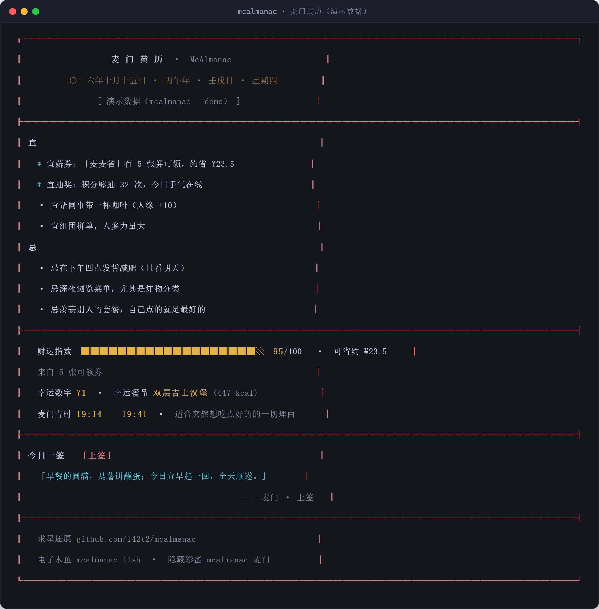
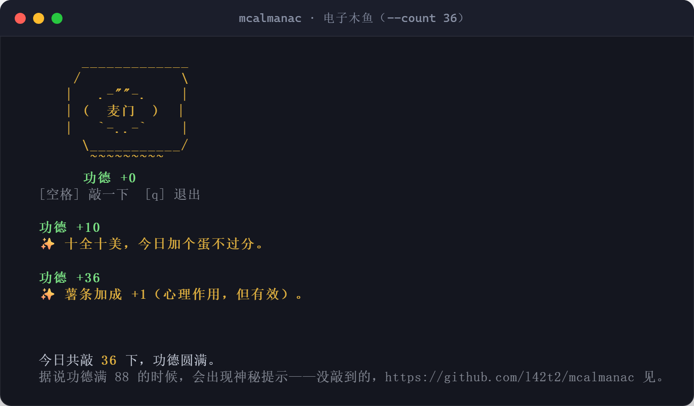

<div align="center">

# 🥠 麦门黄历 · McAlmanac

**把麦当劳 MCP 的真实数据，变成一份每天能摇的电子黄历**

优惠券 · 积分 · 抽奖 · 活动 · 营养 → 宜 / 忌 / 财运 / 签文

[](https://github.com/l42t2/mcalmanac/stargazers)
[](./LICENSE)
[](https://www.python.org/)
[](https://open.mcd.cn/mcp)
[](https://github.com/M-China/mcd-developer-innovation-challenge)

[✨ 功能](#-功能一览) · [🚀 30 秒上手](#-30-秒上手零门槛) · [🎮 在线体验](https://l42t2.github.io/mcalmanac/) · [🔧 工作原理](#-工作原理) · [⭐ 点星理由](#-给麦门黄历点个-star-的理由)



</div>

---

## 这是什么？

一个基于**麦当劳 MCP** 的「玄学 + 实用」小工具。它把你账户里冷冰冰的优惠券、积分、活动数据，翻译成一份**每天想打开看一眼**的电子黄历：

- **宜 / 忌**：从真实数据推导 —— 「宜薅券：麦麦省有 5 张券可领，约省 ¥23.5」「忌抽奖：积分还差 80 分」
- **财运指数**：券 + 积分 + 活动综合评分，附今日可省金额
- **今日一签**：36 支麦门风味签文（含 1 支隐藏彩蛋签），同一天结果稳定，摇出来可以发朋友圈
- **顺手的实用功能**：`save` 一键领券、`points` 积分决策、`card` 生成分享卡、`fish` 电子木鱼

> 全部计算在本地完成，零第三方依赖；没有 MCP Token 也能用 `--demo` 完整玩一遍。

## ✨ 功能一览

| 命令 | 作用 | 玄学含量 |
| --- | --- | --- |
| `mcalmanac`（默认） | 今日黄历：宜忌、财运指数、幸运数字/餐品、麦门吉时、签文 | 🥠🥠🥠🥠🥠 |
| `mcalmanac save` | 省钱雷达：可领券清单 + 合计可省；`--yes` 一键真实领取 | 🥠 |
| `mcalmanac points` | 积分玄学：余额 / 过期提醒 / 够抽几次 / 今日宜忌抽奖 | 🥠🥠🥠 |
| `mcalmanac card` | 生成复古黄历风 HTML 分享卡（截图即可传播） | 🥠🥠🥠🥠 |
| `mcalmanac fish` | 电子木鱼：敲出「功德 +1」，88 下有神秘提示 | 🥠🥠🥠🥠🥠 |
| `mcalmanac doctor` | 连接自检：Token、端点、工具清单一把梭 | 🥠 |
| `mcalmanac star` / `mcalmanac 麦门` | 隐藏彩蛋，自己看 | 🥠🥠🥠🥠🥠 |

## 🚀 30 秒上手（零门槛）

```bash
git clone https://github.com/l42t2/mcalmanac
cd mcalmanac
python -m mcalmanac --demo      # 无需任何配置，先摇一卦
```

零依赖，Python 3.9+ 即可。想装成全局命令：

```bash
pip install .        # 之后直接 mcalmanac --demo
```

### 连接真实数据（可选，强烈推荐）

1. 打开 [open.mcd.cn/mcp](https://open.mcd.cn/mcp)，手机号登录 → 右上角「控制台」→ 激活，复制 MCP Token
2. 设置环境变量（Token 只存本地，永不入库）：

```bash
# Windows PowerShell
$env:MCD_MCP_TOKEN = "你的Token"
# macOS / Linux
export MCD_MCP_TOKEN="你的Token"
```

3. 摇一卦，这次是真实数据：

```bash
mcalmanac doctor     # 先自检：应该显示「服务端共 N 个工具」
mcalmanac            # 今日黄历（真实优惠券/积分/活动）
mcalmanac save --yes # 真实领取全部可领优惠券
```

> 在 **WorkBuddy** 中也可作为连接器 + Skill 使用：把 `mcp-config.example.json` 填入自定义 MCP，再把 `skills/mcalmanac/` 拷入技能目录即可。

## 🎮 在线体验

没有装 Python？打开网页版摇一卦：**https://l42t2.github.io/mcalmanac/** —— 纯前端演示（含可点击的电子木鱼 🪵）。

## 🖥️ 效果预览

终端版：



电子木鱼（`mcalmanac fish`，敲满 88 有惊喜）：



## 🔧 工作原理

```
麦当劳 MCP（6 个只读 Tool 并行调用）
   ↓  容错解析（返回结构没公开？宽进严出）
本地黄历引擎（日期 + 数据摘要 → SHA-256 播种确定性运势）
   ↓
终端黄历 / HTML 分享卡 / --json 机器可读输出
```

- **确定性玄学**：同一天 + 同一份数据 = 同一卦。换设备、重运行都一样，这才叫「黄历」。
- **数据感应的宜忌**：券多就宜薅、积分不够就忌抽奖、有活动就宜参加 —— 玄学外壳，数据内核。
- **优雅降级**：没 Token 自动演示模式；单项接口失败不影响整卦；401/403/429 全有中文排查指引。

细节见 [MCP_INTEGRATION.md](./MCP_INTEGRATION.md)，14 项单元测试见 `tests/`。

## 🌟 给麦门黄历点个 Star 的理由

- **玄学理由**：据说点过 Star 的人，抽奖手气 +10%（未经验证，但也没被证伪）
- **实用理由**：你每点一个 Star，就有更多机会看到它更新「黄历语料库」——下一支签可能就是说给你听的
- **收藏理由**：麦当劳每年都发券，一个顺手的省钱 + 摸鱼工具值得留在 Star 列表里
- **彩蛋理由**：敲满 88 下木鱼，你会知道它想说什么

<a href="https://star-history.com/#l42t2/mcalmanac&Date">
  
</a>

## 📁 项目结构

```
mcalmanac/
├── mcalmanac/              # 零依赖 Python 包
│   ├── mcp_client.py       #   麦当劳 MCP Streamable HTTP 客户端
│   ├── data.py             #   容错解析 + 演示数据
│   ├── fortune.py          #   干支历 + 确定性运势引擎 + 签文池
│   ├── render.py           #   终端渲染 + HTML 分享卡
│   └── cli.py              #   命令行
├── skills/mcalmanac/       # WorkBuddy Skill 包（SKILL.md）
├── docs/                   # GitHub Pages 在线 Demo
├── tests/                  # 单元测试（python -m unittest discover -s tests）
├── MCP_INTEGRATION.md      # MCP 集成说明（Server/Tool/流程/价值）
└── workbuddy.md            # WorkBuddy 开发对话上下文
```

## ❓ FAQ

**Q：Token 安全吗？**
只从环境变量读取，不落盘、不上传；提交的配置示例仅含占位符。`save --yes` 是唯一的写操作，且需要你显式加参数。

**Q：为什么是黄历？**
优惠券和积分是「数据」，但普通人需要的是「今天该做什么」。黄历是中文世界最自然的每日决策界面 —— 顺便，它真的很好玩。

**Q：Windows 终端显示乱码？**
用 Windows Terminal 或先执行 `chcp 65001`；不支持颜色的终端会自动降级为纯文本。

**Q：这是麦当劳官方产品吗？**
不是。本项目是「1024 程序员节 · 麦当劳程序员创意开发大赛」参赛作品，由参赛者独立开发；餐品、价格、活动信息以麦当劳官方渠道实时结果为准。

## 📜 声明与许可

- [MIT License](./LICENSE)
- [参赛声明 CONTEST_DECLARATION.md](./CONTEST_DECLARATION.md)
- 本项目非麦当劳官方产品；「麦门」为网络文化用语。项目输出仅供娱乐参考，不构成任何专业建议。

<div align="center">
<sub>薯条在手，天下我有 —— 如果这份黄历让你多省了一块钱，记得回来点个 ⭐</sub>
</div>
